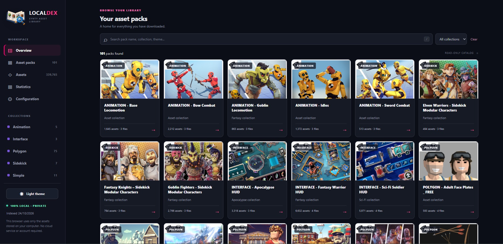

# Synty Library — Local Dex & Downloader

A **local, private browser** for the Synty assets you own. Use the Web UI to install the downloader, synchronize your purchases, index the downloaded files, and search your asset library.



*Local Dex overview, showing the sidebar, package covers, collections, and search.*

> **Independent project:** This is an unofficial, local tool inspired by SyntyDex; it is not affiliated with Synty Studios. Downloads require your own authorized [Synty Store](https://syntystore.com/) account. Assets remain subject to their original licenses.

## Quick start (Windows 11)

**Requirements:** Windows 11 and **Python 3.10+**. You only need Python to start the Web UI; the **Configuration** page can then install and repair the downloader's other dependencies (including Playwright Chromium).

1. Clone or extract this repository. Keep these three directories **next to each other**. The drive letter and parent directory do not matter.
2. Double-click **`SyntyLocalDex/open_local_dex.cmd`**. Local Dex opens a browser at **http://127.0.0.1:8765**. Leave the console open while using the site.
3. Open **Configuration** in the left sidebar, then follow the steps below. On a fresh checkout, Local Dex can create an initial empty index and library folder automatically.

If Python is not available yet, install Python 3.10+ first (or use `SyntyDownloader/install_synty_sync.cmd` as a bootstrap installer), then open Local Dex.

### Set up everything from Configuration

| Action in Configuration | What to do |
| --- | --- |
| **Install / Repair** | Installs or checks the downloader environment, Python packages, and Chromium. The status panel reports whether the downloader is ready. |
| **Open config.yaml** | Edit your Synty account details and verify that `output_dir` is set to `../SyntyLibrary`. If the file does not exist, first copy `SyntyDownloader/config.example.yaml` to `SyntyDownloader/config.yaml`. |
| **Sync downloads** | Signs in using your account and fetches missing downloadable files. Complete the email verification code (2FA) when prompted. Use **Headless mode** only with a valid saved login session. |
| **Sync assets / Rebuild index** | Scans `SyntyLibrary`, refreshes the searchable index and pack covers, and updates the browser with new assets. |

The page displays **installation readiness, operation state, last execution dates, and recent logs**. Run **Sync assets / Rebuild index** after the initial download, or whenever files change. The downloader does not delete or overwrite your existing downloaded files.

> **Prefer command-line tools?** `SyntyDownloader` is fully usable **without Local Dex or its Web UI**. See [Run the downloader directly](#run-the-downloader-directly) below. Similarly, `SyntyLocalDex/rebuild_local_dex.cmd` can index an existing library without downloading anything.

## Browse your library

The left sidebar provides:

- **Overview / Asset packs** — browse pack covers, collections, and package contents. Clicking a pack opens its indexed assets and downloaded files.
- **Assets** — search individual files, filter by collection/type/category/engine, and switch between **Grid** and **List** views using the controls above the results. List view shows each filename, source path, package, asset type, and engine. Your chosen view is remembered in this browser.
- **Asset Details** — appears on the Assets page after selecting a file. Inspect its preview, origin, and local path; drag its left edge to resize the panel.
- **Statistics** — explore totals, storage, collections, asset types, and largest packages.
- **Configuration** — check readiness, install/repair the downloader, run download synchronization, rebuild the asset index, and view operation logs.

The search lists load more results automatically as you scroll. A manual **Load more** button remains available. A sidebar toggle switches between **Light** and **Dark** themes; your choice is saved locally in your browser.

**Preview support:** common images, animated GIFs, video, audio, OBJ geometry, and supported FBX static meshes (including inside ZIP and Unity packages). FBX materials, textures, rigging, and animation are not fully reconstructed; unsupported formats still provide file metadata. Archive inspection and previews do not require modifying your original downloads.

## Repository layout

```text
Synty/                          # Move this parent directory anywhere
├── README.md
├── docs/
│   └── overview.jpg            # Screenshot shown above
├── .gitignore
├── SyntyDownloader/
│   ├── config.example.yaml     # Safe configuration template (tracked)
│   ├── config.yaml             # Your private configuration (ignored by Git)
│   ├── synty_sync.py
│   └── install_synty_sync.cmd
├── SyntyLibrary/
│   └── <package name>/         # Downloaded files (ignored by Git)
│       ├── Preview.jpg
│       └── SourceFiles.zip
└── SyntyLocalDex/
    ├── open_local_dex.cmd
    ├── rebuild_local_dex.cmd
    ├── local_dex_web/          # Local Web UI
    └── .localdex/              # Generated database and caches (ignored)
```

Paths are relative to the sibling folders; **`D:\Synty` is not required**. `SyntyDownloader/config.yaml` should use:

```yaml
output_dir: ../SyntyLibrary

login:
  email: "your-email@example.com"
  password: ""            # Usually not needed for email-code sign-in
  customer_id: "YOUR_CUSTOMER_ID"
```

Use your own Synty customer ID. Do not commit `config.yaml`, Chromium profiles, credentials, or downloaded files.

## Run the downloader directly

This is optional if you use the **Configuration** page. You can run synchronization independently on Windows:

1. Configure `SyntyDownloader/config.yaml` (copy it from `config.example.yaml` if necessary).
2. Run `SyntyDownloader/install_synty_sync.cmd` once to install or repair dependencies.
3. Run `SyntyDownloader/run_synty_sync.cmd` for the normal two-stage interactive/headless download sequence. Alternatively, from `SyntyDownloader/`:

```powershell
.\.venv\Scripts\python.exe .\synty_sync.py --check-config
.\.venv\Scripts\python.exe .\synty_sync.py --limit-packages 1
.\.venv\Scripts\python.exe .\synty_sync.py --headless
```

The downloader uses the configured `output_dir`, preserves existing files, and records download history for incremental syncs. You can also refresh the Dex catalog independently with `SyntyLocalDex/rebuild_local_dex.cmd`.

## Data, privacy, and troubleshooting

- **Local-only:** The Web UI listens on `127.0.0.1:8765`; it is not a hosted/cloud catalog. Downloading from Synty Store does require internet access.
- **Private files:** The root `.gitignore` excludes downloaded assets, browser sessions, download history, secrets, virtual environments, `__pycache__`, the `.localdex` database, and other generated files.
- **Missing Python:** Install Python 3.10+ and restart `open_local_dex.cmd`.
- **Downloader not ready:** Open **Configuration**, check the status text, configure `config.yaml`, and select **Install / Repair** when appropriate.
- **Verification code or expired session:** Run a non-headless download sync to complete login in Chromium or the Configuration panel.
- **Missing/new files in search:** Use **Configuration → Sync assets / Rebuild index**.
- **Server port already in use:** Close the existing Dex window/server, or start `local_dex_server.py --port 8766` from the Dex directory.

For implementation details, see the component-specific documentation: [`SyntyDownloader/README_synty_sync.md`](SyntyDownloader/README_synty_sync.md) and [`SyntyLocalDex/README_LOCAL_DEX.md`](SyntyLocalDex/README_LOCAL_DEX.md).

## License

The original project source code in **SyntyDownloader** and **SyntyLocalDex**
is distributed under the **GNU General Public License v3.0 only**
(`GPL-3.0-only`). See [LICENSE](LICENSE) for the full text and
[NOTICE](NOTICE) for project attribution.

You may use, study, modify, and redistribute the code, including
commercially. If you **distribute** a modified version, GPLv3 requires
you to meet its copyleft and corresponding-source requirements, keep
applicable notices, and identify your changes. Private modifications
that you do not distribute do not have to be published solely because
you modified the code. Prior copies already distributed under Apache-2.0
retain the permissions granted for those copies.

**Synty assets are excluded:** Downloaded packs and their contents are
third-party material, not relicensed by this repository. Follow Synty
Store's terms and the licenses accompanying each pack.
